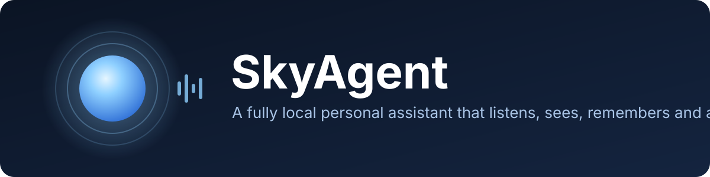
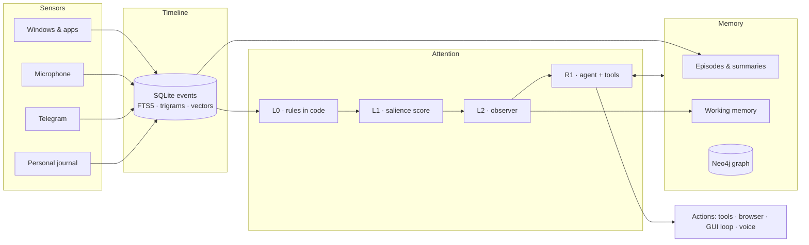

<p align="center">
  
</p>

<p align="center">
  <b>A fully local personal AI assistant for Windows.</b><br>
  It listens to your microphone, follows what happens on screen, reads Telegram, remembers your day,<br>
  answers by voice and does things on your computer. No cloud: models run in Ollama, data stays on your disk.
</p>

<p align="center">
  
  
  
  
  
  
  
</p>

> [!WARNING]
> **🚧 Work in progress.** SkyAgent is under active development. Things change often, some parts are
> unfinished (see the [roadmap](#-roadmap)), and it is tuned for one machine. Expect rough edges.

<p align="center">
  <a href="#%EF%B8%8F-the-cli-is-the-heart">The CLI</a> •
  <a href="#-features">Features</a> •
  <a href="#-how-it-works">How it works</a> •
  <a href="#-getting-started">Getting started</a> •
  <a href="#-usage">Usage</a> •
  <a href="#-configuration">Configuration</a> •
  <a href="#-roadmap">Roadmap</a>
</p>

---

## ⌨️ The CLI is the heart

**[`cli.py`](cli.py) is SkyAgent.** It is the main process: the memory, the sensors, the agent, the observer,
the sleep phase and the voice all live inside it. Everything else (the mini window, the launchers) is a thin
layer around it.

```bash
python cli.py --model gemma4:12b-it-q4_K_M
```

- **Rich, colored terminal UI**: answers stream as they are typed, tool calls are visible as they happen.
- **Never blocks you**: long tasks go to the background (`/jobs`, `/stop N`), you keep typing; `Ctrl+C` interrupts an answer.
- **Asks before dangerous actions** (unless you run it with `--yes`).
- **30+ slash commands** to look into memory, diaries, the graph, sensors and models ([see below](#cli-commands)).

| Flag | Effect |
|---|---|
| `--model NAME` | Ollama model for the agent |
| `--yes` | Run everything without confirmation |
| `--mini` | Also open the mini window |
| `--live` | Show recognized speech as it comes |
| `--tts off\|voice\|all` | Voice replies mode |
| `--no-mic` · `--no-windows` · `--no-telegram` | Turn off a sensor |
| `--no-episodes` · `--no-observer` · `--no-sleep` · `--no-graph` · `--no-context` | Turn off a memory layer |

---

## ✨ Features

| | |
|---|---|
| 🧠 **Memory of your day** | Every event (active window, speech, messages, notes) goes into a timeline. Ask in the evening *"what did I do after lunch and what did I talk about?"* and get an answer with times and links to events. |
| 🎙️ **Always-on voice** | Streaming Silero VAD + Vosk (CPU) or Whisper (GPU). Only text is stored, never raw audio. A voice print tells **you** apart from other people. |
| 🗣️ **"Sky, …" commands** | Say *"Sky, remind me at 6 to call mom"*. Commands run only on **your** voice, never from a video or someone else. |
| 🖥️ **Works with your PC** | Shell, Python, files, apps, keyboard, mouse, windows, web search. Drives GUIs through UI Automation in the background, so it **doesn't steal your mouse or focus**. |
| 🌐 **Its own browser** | A headless Edge (Playwright) with a separate profile: open, click, type, read, download. |
| 👁️ **Vision** | Understands screenshots and images; a small vision model finds exact click targets (1–2 px error). |
| ✅ **Self-check** | After every change the agent must verify the result (open the file, run the calculator, look at the wallpaper). Enforced in code, not just the prompt. |
| 🌙 **Sleep phase** | While you are away, a heavier model cleans memory: fixes speech-recognition errors, drops junk, tags episodes, links entities in the graph. |
| 💬 **Telegram diary** | Reads your chats (read-only, never marks as read) into per-source daily diaries. |
| 🔊 **Voice replies** | Local TTS with Piper (or the built-in Windows voice). Echo of its own voice is filtered out of the mic. |
| 🫧 **Mini window** | A small glass "orb" in the corner of the screen that breathes, glows with your voice and opens a chat / diary panel (`Ctrl+Alt+Space`). A companion to the CLI, written with [Claude Code](https://claude.com/claude-code). |
| 🎛️ **VRAM manager** | Keeps the working model fully inside 12 GB of VRAM, so generation never falls to ~1 token/s. |

---

## 🧩 How it works



**Core principles**

1. **Raw data is the source of truth.** Summaries, diaries and the graph are derived from the timeline and can be rebuilt.
2. **The model decides *what*; code decides *when*.** No raw stream goes into the LLM, only a compact state and what changed.
3. **Cheap before expensive.** Every event passes code filters first, then a cheap score; only a small part reaches the LLM.
4. **Other people's text is data, not commands.** A chat message can't trigger a dangerous action on its own.
5. **Rules the model might forget live in code.** Reminder deadlines, video-audio protection, self-checks.
6. **Privacy, even locally.** Exclusions, pause, retention limits, real deletion on request.

The full design (in Russian) is in [`docs/ARCHITECTURE.md`](docs/ARCHITECTURE.md).

---

## 🚀 Getting started

### Requirements

- **Windows 10/11** (uses UI Automation, WASAPI, acrylic windows)
- **Python 3.12** and [uv](https://github.com/astral-sh/uv) (or plain `pip`)
- **[Ollama](https://ollama.com)**
- **NVIDIA GPU with ~12 GB VRAM** recommended (developed on an RTX 5070 Ti Laptop)
- *Optional:* **Neo4j 5** Community with APOC and GDS for graph memory. Without it, everything else still works.

### Install

```bash
git clone https://github.com/the-volador42/skyagent.git
cd skyagent
uv venv .venv
uv pip install -r requirements.txt
```

Pull the models:

```bash
ollama pull gemma4:12b-it-q4_K_M   # main model: agent, summaries, observer, vision
ollama pull qwen3-vl:4b            # precise clicks on screenshots
ollama pull bge-m3                 # embeddings
```

Speech and voice models go into `models/`:

```bash
.venv\Scripts\python.exe scripts\get_tts_voice.py   # Piper voice (~60 MB)
```

- **Speech recognition:** download [`vosk-model-ru-0.42`](https://alphacephei.com/vosk/models) into `models/` (the `rescore/` and `rnnlm/` folders are not needed).
- **Voice print:** `wespeaker_en_voxceleb_resnet34_LM.onnx` from the [sherpa-onnx speaker models](https://github.com/k2-fsa/sherpa-onnx/releases/tag/speaker-recongition-models) into `models/`.

Create your config:

```bash
copy .env.example .env
```

### Run

```bash
SkyAgentCLI.bat
```

The launcher starts Ollama and Neo4j if they aren't running, then runs `cli.py` together with the mini window.
Or start the CLI directly (Ollama must already be running):

```bash
.venv\Scripts\python.exe cli.py --model gemma4:12b-it-q4_K_M --mini
```

---

## 💡 Usage

Just type (or say *"Sky, …"*) what you need:

```text
› what was I doing around 3 pm?
› find where we talked about Docker yesterday
› make a calculator in Python and test it
› open github.com in your browser and download the latest release
› remind me in 20 minutes to stretch
```

### CLI commands

| Command | What it does |
|---|---|
| `/status` | Sensors, models, VRAM |
| `/pause` · `/resume [mic\|windows\|telegram]` | Pause or resume sensors |
| `/today` · `/find` · `/live` | Today's timeline, search, live event feed |
| `/episodes` · `/summary` | Episodes and daily summary |
| `/diary [name] [day]` · `/note [text]` | Diaries and personal journal |
| `/memory` · `/done` · `/drop N` · `/graph name` | Working memory and the graph |
| `/observer [now\|pause\|resume]` | The background observer |
| `/enroll [reset]` | Record your voice print (25–60 s of speech) |
| `/sleep [now\|pause\|resume]` · `/junk` · `/restore N` | Sleep phase and junk bin |
| `/tts [off\|voice\|all\|stop\|test]` | Voice replies |
| `/mini` · `/model` · `/auto` | Mini window, model, auto-approve |
| `/jobs` · `/stop N` · `/clear` · `/exit` | Background jobs, history, exit |

---

## ⚙️ Configuration

All settings are environment variables, documented in [`.env.example`](.env.example). The most useful ones:

| Variable | Default | Meaning |
|---|---|---|
| `SKYAGENT_MODEL` | `gemma4:12b-it-q4_K_M` | Main model |
| `SKYAGENT_STT` | `vosk` | `vosk` (CPU) or `whisper` (GPU) |
| `SKYAGENT_TTS` | `voice` | `off` · `voice` (on "Sky, …" and reminders) · `all` |
| `SKYAGENT_CTX` | `32768` | Context window |
| `SKYAGENT_GUI` | background | `foreground` to use the real mouse and focus |
| `SKYAGENT_BROWSER_SHOW` | `0` | Show the agent's browser window |
| `SKYAGENT_MINI` | `1` | `0` to start the CLI without the mini window |
| `SKYAGENT_VERIFY` | `1` | `0` to turn off self-checks |
| `TG_API_ID` · `TG_API_HASH` | — | Telegram, then log in once with `scripts\telegram_login.py` |

---

## 📁 Project structure

```text
skyagent/
├── cli.py                 # ⭐ main process: memory, sensors, agent, voice
├── mini.py                # glass mini window (PySide6), written with Claude Code
├── SkyAgentCLI.bat        # launcher: Ollama + Neo4j + CLI
├── skyagent/
│   ├── core.py            # agent loop with tools and guards
│   ├── tools.py           # shell, files, apps, input, web, vision
│   ├── verify.py          # self-check after changes
│   ├── screen.py · bgui.py · winctl.py   # GUI loop without stealing focus
│   ├── browser.py         # agent's own headless browser
│   ├── gpu.py             # VRAM manager
│   ├── tts.py             # voice replies
│   ├── triggers.py        # "Sky, …" and other triggers
│   ├── bridge.py          # CLI ↔ mini window bridge
│   ├── sensors/           # windows, audio, speaker, telegram
│   └── memory/            # timeline, episodes, diaries, working memory,
│                          # observer, graph, sleep phase, recall tools
├── scripts/               # Neo4j, TTS voice, Telegram login
└── docs/ARCHITECTURE.md   # full design
```

> `web.py` and `desktop/` (Electron) are early prototypes from stage 0. They have no memory and are no longer developed.

---

## 🗺️ Roadmap

| # | Stage | Status |
|---|---|---|
| 1 | Timeline, window sensor, recall tools | ✅ Done |
| 2 | Sound: microphone + PC audio, VAD, speech recognition | 🟡 Mic done, PC audio (loopback) next |
| 3 | Working memory + observer | ✅ Done |
| 4 | Graph memory: extraction, matching, nightly consolidation | 🟡 Groundwork + sleep phase done |
| 5 | Messengers + access policy | 🟡 Telegram (read-only) done, risk levels next |
| 6 | Proactivity: tasks, subscriptions, notification budget | 🟡 Notification budget done |

Beyond the plan: "Sky, …" voice commands, voice replies, mini window, own browser, background GUI control, self-check, personal journal.

---

## 🔒 Privacy

- Everything runs on `127.0.0.1`. No telemetry, no cloud APIs.
- Raw audio is never saved, only recognized text.
- Password managers and private/incognito windows are logged as *"hidden"*.
- Sensors can be paused at any time; the voice print is deleted with `/enroll reset`.
- Your data lives in `data/` and is excluded from git.

---

## 🤝 Credits

- The GUI, the mini window [`mini.py`](mini.py), was written with the help of [Claude Code](https://claude.com/claude-code).
- Built on [Ollama](https://ollama.com), [Neo4j](https://neo4j.com), [Vosk](https://alphacephei.com/vosk/),
  [faster-whisper](https://github.com/SYSTRAN/faster-whisper), [sherpa-onnx](https://github.com/k2-fsa/sherpa-onnx),
  [Piper](https://github.com/rhasspy/piper), [Playwright](https://playwright.dev), [Rich](https://github.com/Textualize/rich)
  and [PySide6](https://doc.qt.io/qtforpython-6/).

---

<p align="center">
  Made with ☁️ and a lot of local GPU time.
</p>
